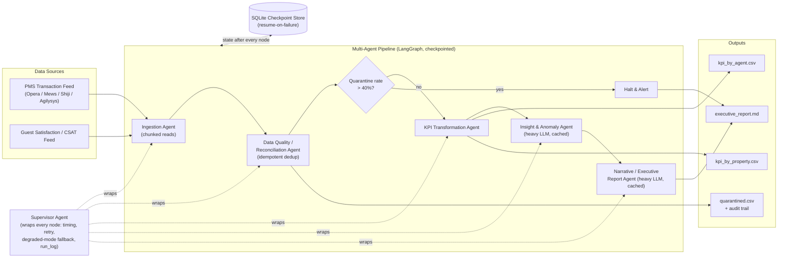

# Architecture: FPG-Style Frontline Performance Pipeline

## 1. Purpose & Framing

This pipeline is a small-scale architectural analogue of what FPG's own product
line (**IN-Gauge** for real-time PMS-connected transaction tracking, **IN-Sights**
for analytics/reporting/forecasting) does conceptually: capture frontline-agent
transactions from property systems, reconcile/validate them, compute upsell and
revenue KPIs, and turn those KPIs into coaching-ready insight for regional
performance managers.

It's built as a **multi-agent pipeline** rather than a single script for a
concrete architectural reason: the stages have genuinely different risk profiles,
cost profiles, and failure modes, and separating them lets each be engineered,
scaled, and governed independently.

## 2. System Context

This mirrors FPG's real split between an **operational capture layer** (IN-Gauge,
PMS-synchronized, transaction-level, audit-trailed) and an **analytics/reporting
layer** (IN-Sights, aggregated, forward-looking, human-facing) — the Ingestion +
Data Quality agents are the IN-Gauge analogue; KPI + Insight + Narrative are the
IN-Sights analogue.

## 3. Agent Responsibility Table

| Agent | Input | Output | LLM Tier | Failure Handling |
|---|---|---|---|---|
| **Ingestion** | Raw CSV / PMS feed path | Tagged `raw_df` + source manifest | None (rule-based) | Fails fast on unreadable source; no partial ingestion |
| **Data Quality / Reconciliation** | `raw_df` | `clean_df`, `quarantined_df`, `quality_report` | None (rule-based) | Never raises — bad rows are quarantined with a reason code and an `audit_status` (`APPROVED`/`ERROR`), never silently dropped |
| **KPI Transformation** | `clean_df` | Per-agent & per-property KPI tables, `kpi_overall` | None (pure pandas) | Deterministic; same input always produces same output — critical for auditability of revenue numbers |
| **Insight & Anomaly** | KPI tables | List of typed insights (`risk`/`opportunity`/`top_performer`/`anomaly`) | **Heavy** | On missing API key / bad JSON response, falls back to a deterministic heuristic (top performer by revenue, lowest-conversion agent) so the pipeline never produces zero insights |
| **Narrative / Executive Report** | KPI tables + insights | Markdown executive report | **Heavy** | On missing API key, falls back to a templated (non-LLM) report built from the same data, so a report is always produced |
| **Orchestrator (LangGraph)** | — | Drives the graph, owns the quality gate | — | Conditional edge halts the pipeline *before* the two paid LLM calls if quarantine rate exceeds 40% — a cost and correctness safeguard, not just an error path |
| **Supervisor (wraps all agents)** | — | `run_log` entries, retry attempts, degraded-mode flag | — | See §7 — retries every agent, then either invokes that agent's own `degraded_fallback` (Insight/Narrative) or re-raises to let the checkpoint capture a resumable failure (Ingestion/Data Quality/KPI) |

## 4. Data Contract Between Agents

All agents read from and write to one shared, validated object: `PipelineState`
(`src/state.py`), a pydantic model. This is the architectural choice that keeps
the agents loosely coupled — each agent only needs to know the shape of the
state fields it touches, not the internals of any other agent. Key fields:

- `raw_df_path`, `clean_df_path`, `quarantined_df_path`, `kpi_by_agent_path`,
  `kpi_by_property_path` — **paths to parquet files**, not DataFrames (see
  below); `PipelineState` exposes `.raw_df`, `.clean_df`, etc. as properties
  that load-on-access, so agent code reads `state.clean_df` exactly as if it
  were stored inline
- `quality_report`, `quarantine_rate`, `duplicate_rows_skipped` — the reconciliation summary the gate decides on
- `kpi_overall` — the analytics layer's contract with the LLM agents
- `insights` — a typed list of dicts (`type`, `subject`, `summary`, `recommended_action`), the contract between the Insight and Narrative agents
- `executive_report_md`, `errors` — final output and error/audit trail
- `run_log`, `degraded_mode` — the Supervisor's observability contract (§7)

**Why paths instead of inline DataFrames:** the graph is checkpointed (§7) —
LangGraph serializes `PipelineState` to SQLite after every node completes.
Its serializer can't encode a `pandas.DataFrame` at all, and even if it
could, inlining multi-megabyte tables into every checkpoint write is the
wrong pattern — real checkpoint backends (Redis, Postgres, a managed
workflow store) don't want that either. Instead, each DataFrame-producing
agent spills its result to a per-run parquet file
(`src/dataframe_store.py`, under `.cache/dataframes/<run_id>/`) and stores
only the file path in state. This keeps every checkpoint small and fast to
write regardless of data volume, and doubles as part of the
memory-efficiency story (§7.3): intermediate results live on disk between
stages, not duplicated across every in-memory checkpoint snapshot.

Using pydantic here (rather than a raw dict) means the contract is enforced and
self-documenting, and a future agent added to the graph can't silently
misinterpret another agent's output shape.

## 5. Why LangGraph (and why multi-agent at all)

**Why not one script?** Because the stages have different engineering
requirements:
- Ingestion/Data Quality/KPI are **deterministic and cheap** — they should run
  on every batch, be fully unit-testable, and never depend on network calls.
- Insight/Narrative are **non-deterministic and costly** — they call an LLM,
  should be retried/rate-limited independently, and are the only stages worth
  spending a heavier (and more expensive) model on.

Collapsing these into one script would force every stage to share the same
retry/error/cost characteristics, which is wrong for both halves.

**Why LangGraph specifically:**
- **Explicit state machine** — the flow (including the conditional quality
  gate) is declared as a graph, not buried in `if/else` branching, which makes
  the control flow reviewable and diagrammable (see §2).
- **Conditional routing as a first-class concept** — the quarantine-rate gate
  is a graph edge, not an exception handler; it's part of the documented
  architecture, not a bolt-on.
- **Per-node retry/observability hooks** — LangGraph nodes can be individually
  retried, traced, and checkpointed, which matters once Insight/Narrative are
  calling paid, occasionally-flaky LLM APIs in production.
- **Incremental extension** — adding a new stage (e.g. a human-approval node
  before coaching notes go out) is one new graph node and edge, not a rewrite.

## 6. Cost/Latency Trade-off: Model Tiering

The **Insight** and **Narrative** agents are the only two that call an LLM, and
both default to a heavier model (`claude-sonnet-5`) because they do the two
tasks in this pipeline that genuinely require judgment: spotting a
non-obvious pattern across dozens of agents/properties, and writing a report
that reads as coherent prose rather than a template. Every other agent —
ingestion, validation, aggregation — is deterministic pandas/rule logic,
because using an LLM there would add cost, latency, and non-determinism to
work that a rules engine already does correctly, cheaply, and auditably.

This tiering is **not hardcoded** — it lives entirely in `config/agents.yaml`,
which maps each agent to a `provider` + `model`. The LLM client
(`src/llm_client.py`) is provider-agnostic: Anthropic is called via its native
SDK, and every other provider (OpenAI, NVIDIA NIM, a local Ollama server, or
any other OpenAI-compatible endpoint) is called through the same
`openai`-SDK-based path with a swapped `base_url`. Downgrading the Insight
agent to a small local model, or pointing it at a hosted open-weight model on
NVIDIA NIM, is a two-line config edit — no code change, no redeploy of agent
logic. This is the concrete mechanism for the "cheap model for routine work,
heavy model for reasoning, configurable per agent" requirement.

## 7. Idempotency, Resumability & Memory Efficiency

These three properties are what separate a demo script from something you'd
actually trust to run unattended against production revenue data. Each is a
deliberate, testable design decision, not a framework default.

### 7.1 Idempotency — three layers, not one

"Idempotent" is underspecified until you say *which* re-run scenario you
mean. This pipeline handles three, at three different layers:

1. **Row-level**: every ingested transaction gets a `transaction_id` —
   a content hash of its natural key columns (hotel, property, agent,
   arrival date, ADR, reservation status — see `src/hashing.py`,
   `NATURAL_KEY_COLUMNS`). The Data Quality agent dedups on this hash, not
   on full-row equality. This matters because a re-delivered PMS batch (a
   very real webhook-retry scenario) can differ in column order or a
   non-key field while still describing the same underlying transaction —
   full-row dedup would miss it, hash-based dedup catches it. Verified: the
   sample dataset ships with 15 injected duplicate rows, and every run
   reports `duplicate_rows_skipped=15` — the same 15, not 0 and not 30, no
   matter how many times the source is re-ingested.

2. **Run-level**: `run_id` defaults to a hash of the source file's *bytes*
   (`src/hashing.py::derive_run_id`), not a timestamp. Re-running against an
   unchanged file reproduces the same `run_id`, which means output files in
   `reports/` are overwritten, not duplicated — invoking `python -m
   src.main` twice against the same input is a no-op replay, verified by
   diffing `kpi_by_agent.csv` byte-for-byte across two consecutive runs.
   `--force-new-run` opts out when you deliberately want a fresh run
   against the same file (e.g. after fixing an agent's logic).

3. **LLM-call level**: the Insight and Narrative agents cache their
   response keyed on a hash of `(provider, model, system prompt, user
   prompt)` (`src/llm_cache.py`). Re-running against unchanged KPI data
   never re-spends tokens on a call that would produce the same result —
   the UI surfaces this directly (`insight_cache_hit` / `narrative_cache_hit`
   in the Run Log tab).

### 7.2 Resumability — real checkpoint/resume, not just retry

The graph is compiled with a LangGraph `SqliteSaver` checkpointer
(`checkpoints.sqlite`, `src/graph.py::_get_checkpointer`), keyed by
`thread_id = run_id`. State is persisted after every node.

The Supervisor Agent (`src/agents/supervisor_agent.py`) makes a deliberate
distinction here that matters more than the checkpointing mechanism itself:

- **Ingestion / Data Quality / KPI** have *no* safe degraded fallback —
  there is no honest way to "gracefully degrade" a KPI table you weren't
  able to compute. After exhausting a small retry budget, the Supervisor
  **re-raises**, which leaves that node's checkpoint incomplete and prints
  a `--resume <run_id>` command. It does **not** silently continue with
  missing data.
- **Insight / Narrative** *do* have a safe fallback (a deterministic
  heuristic / templated report). After exhausting retries, the Supervisor
  calls the agent's own `degraded_fallback` and flips `degraded_mode=True`
  — the run completes with a usable, slightly-less-nuanced result instead
  of failing on what is, in the end, a "nice to have" LLM enrichment step.

Verified end-to-end: a forced crash in the KPI agent produces a `FATAL`
message with a `--resume run-<hash>` command; running that command
reuses the checkpoint and completes in ~0.06s (vs. ~1.8s for the original
run) because ingestion and data-quality validation are *not* re-executed —
only the failed node onward runs again. This is the concrete difference
between "retry a few times and hope" and an actual resume guarantee.

### 7.3 Memory efficiency — bounded by chunk size, not row count

The Ingestion Agent reads the source with `pandas.read_csv(...,
chunksize=state.chunk_size)` and writes each chunk directly to the run's
parquet spill file via a streaming `pyarrow.parquet.ParquetWriter`
(`src/agents/ingestion_agent.py`) — chunks are never accumulated into a
Python list and concatenated at the end. Peak memory during ingestion is
bounded by `chunk_size` (configurable via `--chunk-size` / the Streamlit
sidebar), not by total source row count, so the design scales to files far
larger than available RAM. Combined with the parquet-spill pattern in §4,
no stage after ingestion holds more than one DataFrame in memory at a time
either.

At real FPG scale (2,500+ properties), the next step past chunked file
reads is the same idea applied to a stream instead of a static file — see
the Ingestion row in the scalability table (§8) for how this generalizes
to a Kafka/webhook source.

## 8. Scalability: How This Maps to a Production Setup

At FPG's actual scale (2,500+ hotels, 120+ countries, per the public site),
this prototype's shape stays the same but its implementation of each stage
changes:

| Stage | Prototype (this repo) | Production equivalent |
|---|---|---|
| Ingestion | Local CSV read | PMS webhook consumer / Kafka topic per property, schema-on-read into a landing zone |
| Data Quality | In-process pandas rules | dbt tests / Great Expectations running against a staging table, with quarantine written to a dead-letter table, not a CSV |
| KPI Transformation | In-process pandas | dbt models materialized in the warehouse (Snowflake/BigQuery), orchestrated by Airflow/Prefect/Dagster on a schedule |
| Insight/Narrative | LangGraph nodes calling an LLM synchronously | Same LLM agents, but triggered as a downstream enrichment job off the warehouse tables, with results written back to a `insights` table and served via IN-Sights-style dashboards |
| Orchestration | LangGraph, single process, single run | LangGraph (or the same conditional-DAG logic) as one task inside a broader Airflow/Prefect DAG, so the quality gate can page an on-call engineer, not just print to stdout |

The quality gate is the seam that matters most architecturally: it's the point
where "raw operational data" (IN-Gauge-like) becomes "trusted analytical data"
(IN-Sights-like), and in production that seam is exactly where a data platform
puts its strongest contract — schema validation, freshness checks, and a
circuit breaker before expensive downstream jobs run, which this prototype
already implements in miniature via `QUARANTINE_RATE_THRESHOLD`.

## 9. Extension Points

- **Live PMS integration**: replace `ingestion_agent.run`'s CSV read with a
  webhook/API poll against a real PMS (Opera, Mews, etc.); the rest of the
  graph is unaffected because it only depends on `PipelineState.raw_df`
  having the expected columns.
- **Human-in-the-loop approval**: insert a new graph node between `narrative`
  and `END` that holds the report for manager sign-off before it's
  distributed — a one-node, one-edge change given LangGraph's structure.
- **Additional verticals**: the same graph shape (ingest → reconcile → KPI →
  insight → narrative) applies unchanged to FPG's automotive and car-rental
  verticals; only the KPI agent's column mapping and metric definitions
  would need to change.
- **Streaming instead of batch**: the quality gate's conditional-edge pattern
  generalizes to a streaming setting (e.g. per-micro-batch quarantine-rate
  checks) without changing the agent boundaries.
